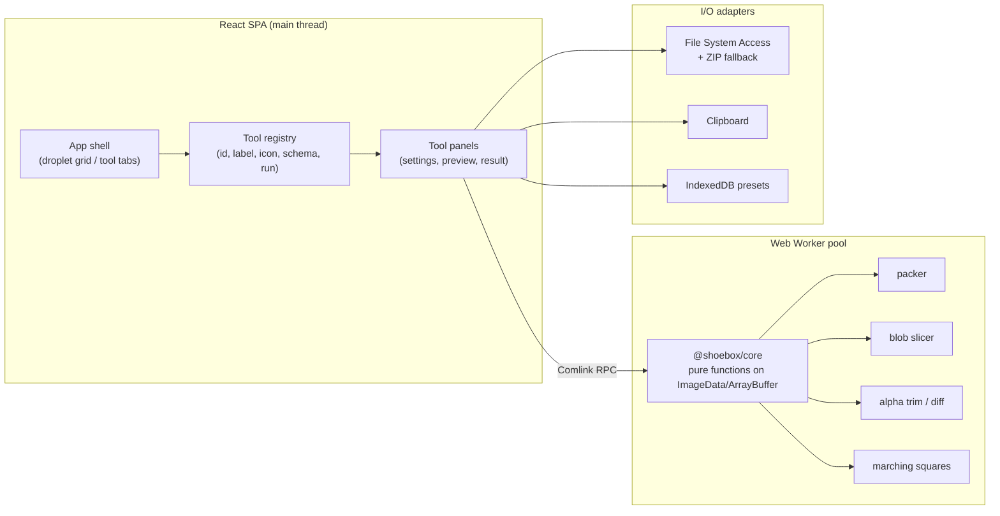

# ShoeBox Web — Recommended Tech Stack

> Companion to `docs/LEGACY_FEATURE_INVENTORY.md`. This is a recommendation, not a final decision;
> section 10 lists what must be answered first.

---

## 1. TL;DR

Build a **100 % client-side, offline-capable web app** — no uploads, no backend for the core tools.

| Layer | Recommendation |
|---|---|
| Build | **Vite** |
| UI | **React 19 + TypeScript + Tailwind CSS + shadcn/ui** (Radix primitives) |
| State | **Zustand** (tool registry + per-tool settings) |
| Settings/forms | **Zod schema → react-hook-form** auto-generated forms (replaces the reflection-based settings window) |
| Image processing | **Canvas 2D + `ImageData` in Web Workers** (`OffscreenCanvas`, `Comlink`) |
| Heavy pixel loops | **Rust → WebAssembly** (`wasm-bindgen`) only where profiling says so |
| Codecs | `@jsquash/*` (mozjpeg / oxipng / webp, WASM) + Canvas `toBlob` + **WebCodecs `ImageDecoder`** for animated GIF |
| GIF/WebP animation | `ImageDecoder` (Chromium) with `gifuct-js` fallback |
| Atlas packing | **Port the legacy guillotine packer to TS** (for output parity); `maxrects-packer` as a second algorithm |
| File output | **File System Access API** (`showDirectoryPicker`) + **`fflate` ZIP** fallback |
| Persistence | `localStorage` for settings, **IndexedDB (`idb`)** for preset library / recent jobs |
| Tests | **Vitest** (pure algorithms) + **Playwright** (E2E) + **pixelmatch/odiff** golden images |
| Optional desktop build | **Tauri 2** wrapping the same SPA (native folder access, no upload, small binaries) |
| Optional backend | Only if "Share Folder" style collaboration survives: **Cloudflare Workers + R2** or **Supabase** |

**The product thesis:** *"Your art never leaves your machine."* Local processing is both a privacy
selling point and by far the cheapest architecture.

---

## 2. Requirements distilled from the legacy app

| # | Requirement | Consequence for the stack |
|---|---|---|
| R1 | Drop many files at once, fast, with instant preview | local file access, no network round-trip; workers |
| R2 | Deterministic pixel algorithms (packing, slicing, trim) | pure TS/WASM modules, golden-image tests |
| R3 | Per-tool settings with presets, shareable | schema-driven forms + JSON presets |
| R4 | Output files (PNG + sidecar XML/JSON/CSS) | multi-file save: directory handle or ZIP |
| R5 | Clipboard in/out (text + image) | `navigator.clipboard` with graceful degradation |
| R6 | Batch jobs over dozens of files | queue + progress + cancellation |
| R7 | Works offline | PWA + no server dependency |
| R8 | Optional legacy Flash inputs | separate, experimental module |

---

## 3. Architecture



**Key architectural rule:** keep the algorithms in a **framework-free package** (`packages/core`) that
takes and returns plain data (`{ data: Uint8ClampedArray, width, height }`, arrays of rects, strings).
The React app is only a shell. This keeps the logic testable, allows a future Tauri/CLI build, and makes
porting from AS3 mechanical.

### Suggested repo layout

```
apps/web                 React + Vite app (shell, tools UI)
packages/core            pure algorithms (packer, trim, slice, hull, templates)
packages/codecs          encode/decode wrappers (canvas / jsquash / WebCodecs)
packages/core/tests      vitest + fixtures + golden images
apps/desktop (optional)  Tauri 2 wrapper
```

### Tool model (replaces `PluginBase`)

```ts
type ToolDef<Cfg> = {
  id: string;                    // stable id, used in presets/URLs
  label: string;
  icon: ReactNode;
  accepts: { files?: string[]; clipboard?: ('text'|'image')[] };
  schema: z.ZodType<Cfg>;        // generates the settings form + validation
  defaults: Cfg;
  presets?: { name: string; cfg: Cfg }[];
  run(ctx: RunContext, input: ToolInput, cfg: Cfg): Promise<ToolResult>;
};

type ToolResult = {
  preview?: ImageBitmap | string;
  files?: { name: string; blob: Blob }[];
  text?: string;                 // copied to clipboard / shown
  warnings?: string[];
};
```

`RunContext` provides `progress()`, `signal` (cancellation), `log()`, and the I/O adapters.
This is a direct, typed evolution of `registerListenEventGetData` + `PluginManager` routing.

> **As implemented:** settings are described by a lightweight `FieldDef[]` (number / boolean / text /
> textarea / select) instead of Zod, and only `progress()` exists so far. Both are internal details that
> can change without touching tool logic.

---

## 4. Feature → web implementation mapping

| Legacy feature | Web implementation | Difficulty | Notes |
|---|---|---|---|
| **Pack Sprites** | Port `build_tree` + binary-search canvas sizing to TS; `ImageData` trim; `@jsquash/png` or canvas encode; template engine for XML/CSS/JSON | Medium | Keep duplicate detection (`pixelmatch`-style diff on premultiplied-off pixels) |
| **Slice Sprites** | Scanline flood fill on `Uint32Array` + label pass; baseline clustering | Medium | O(n) in a worker; big images fine |
| **Ani 2 Sheet (GIF)** | `ImageDecoder` (WebCodecs) for frames, `gifuct-js` fallback | Easy | `ImageDecoder` gives frame timestamps + repetition count |
| **Ani 2 Sheet (SWF)** | Ruffle (WASM) playback + per-frame canvas capture, or serverless FFDec | Hard | Treat as a **spike**, not a commitment |
| **JPGA Bitmap** | JS encode/decode with `createImageBitmap(..., {premultiplyAlpha:'none'})`; blur via canvas filter or WASM | Easy | Watch for premultiplication; keep it as an optional tool |
| **Extract Tiles** | Same offset-scoring algorithm on `Uint32Array` | Medium | Preview-only today; consider "export tileset + JSON" |
| **Spr. Hull** | Marching squares + Douglas–Peucker / angle simplification; export points JSON | Medium | Add the export the original never had |
| **List Files** | Trivial string templating | Easy | Add copy + download |
| **UiToolkit fix** | Canvas downscale + JSON number scaling | Easy | Only if the pipeline still exists |
| **Mac 2 PC url** | Pure string mapping (no OS actions) | Easy | Probably drop |
| **Share Folder** | Needs backend + storage + auth | High | Or replace with "share result link" on an object store |
| **Settings system** | Zod schema + generated form + preset library + `?preset=` share link | Easy–Medium | Supersedes cookie + `::ShoeBox:` clipboard hack |
| **Droplet shell** | CSS grid of drop cards, keyboard shortcuts, command palette | Medium | Keep the fast, no-modal feel |

---

## 5. UX changes the web forces (and how to soften them)

| Legacy behaviour | Web constraint | Proposed UX |
|---|---|---|
| "Write output next to the source file" | Browsers can't write to an arbitrary folder unasked | First save asks for a **folder once** (`showDirectoryPicker`), remembered in IndexedDB — then all outputs land there silently. Fallback: ZIP download. |
| Native window per tool result | No native windows | Right-hand **result drawer** with preview + "Save" / "Copy" / "Download all" |
| Drop a folder | `webkitGetAsEntry`/`FileSystemHandle` differences | Support folder drop in Chromium, multi-select otherwise |
| Paste image at app focus | Clipboard read needs gesture/permission | Dedicated **Paste** button per tool + global `⌘V` listener |
| Right-click droplet → settings | Browsers hijack context menus (avoidable) | Settings icon on card hover + `,` shortcut; keep right-click optional |
| Always-on-top droplet box | Not possible | PWA window + "keep tab pinned"; Tauri build if truly needed |
| OS path conversion | Meaningless | Drop |

**Recommended layout:** left rail of tools (grouped: *Atlases*, *Slicing*, *Animation*, *Utilities*),
main area = drop zone + preview canvas, right drawer = settings + output. Keep the "drop anything on a
tool" model — it is the soul of the original app.

---

## 6. Performance strategy

1. **Never touch pixels on the main thread.** Decode with `createImageBitmap`, transfer to a worker,
   process on `OffscreenCanvas`/`ImageData`, transfer back.
2. **Use a small worker pool** (2–4) for batch jobs; `Comlink` for typed RPC.
3. **Avoid copies**: `Transferable` ArrayBuffers; `ImageBitmap` transfer is zero-copy.
4. **Alpha scans** on `Uint32Array` (one 32-bit read per pixel) — 4–10× faster than per-channel loops.
5. **Atlas limits**: browsers cap canvas size (Chromium ~16k/side, Safari lower area). Detect and either
   downscale, tile, or refuse with a clear message. Consider adding **multi-page atlases** (a real
   improvement over the original, which only made one square sheet).
6. **WASM only after profiling**: packer and slicing are O(n log n)/O(n) and fine in JS; marching squares
   and big blurs are the candidates for Rust.
7. **Streaming encode**: for large PNGs prefer `OffscreenCanvas.convertToBlob()` in a worker.

---

## 7. Delivery options

> **Decided:** browser tab only. No Tauri/Electron build, no backend. Options below are kept for context.

| Option | Pros | Cons | Verdict |
|---|---|---|---|
| **Pure web** | zero install friction, no uploads, works offline, easy updates | no true local folder write outside Chromium, no OS integration | **Chosen** |
| **+ File System Access** | near-native "save into project folder" workflow | Chromium/Edge only | **Chosen, with ZIP fallback** |
| **Tauri 2 desktop** | native folder watching, write-next-to-source, "open in Explorer", small binaries (~5–10 MB), same SPA | per-OS builds, signing | Not now |
| **Electron** | most familiar, huge ecosystem | 100 MB+, memory heavy | Rejected |
| **Server-side processing** | works on any browser, big jobs | uploads (privacy!), cost, latency, offline lost | Rejected |

---

## 8. Collaboration (dropped)

Team hand-off is **out of scope**. Results stay local; sharing happens with the user's own tools
(Slack, Drive, GitHub, WeTransfer). Revisit only if a concrete need appears.

---

## 9. Testing & fidelity

The biggest risk in this port is **silent pixel differences**. Mitigate with fixtures:

1. Build a **fixture set**: a few dozen images (transparent edges, duplicates, 1-px borders, odd sizes,
   fonts, tilesets, animated GIFs).
2. Run the **original ShoeBox** once per fixture and store the outputs as golden files
   (atlas PNG + sidecar XML/JSON/CSS).
3. Unit-test algorithms against the golden files with a small tolerance
   (`pixelmatch` / `odiff`, e.g. ≤ 0.1 % differing pixels, alpha compared separately).
4. Test the **packer geometry** as pure data (rect list) — that must match exactly.
5. E2E: Playwright flows for drop → settings → run → save (with a mocked file system).

---

## 10. Roadmap & current status

| Phase | Scope | Status |
|---|---|---|
| **0 — Shell** | Vite + React + TS, tool registry, droplet rail, schema-driven settings, local persistence, drop/paste plumbing, output layer (folder handle + ZIP) | **Done** |
| **1 — MVP** | **Pack Sprites** (trim, padding, power-of-two, dedupe, Phaser/Unity/Godot/CSS/text metadata), **Slice Sprites**, **List Files** | **Done** |
| **2 — Content tools** | Ani 2 Sheet (GIF only), Extract Tiles, Sprite Hull + polygon export | **Done** |
| **3 — Polish** | Multi-page atlases, batch queue UI, baseline alignment for slicing, a11y, golden-image fixtures | Next |
| **Distribution** | GitHub Pages workflow + Cloudflare Pages (`shoebox.lacgame.com`) | **Done** |
| **Dropped** | SWF (any form), collaboration/share folder, JPGA, Mac↔PC paths, UiToolkit fix, FlickrWP, Code Inspect, shareable preset links | Out of scope |

**Notes on the implementation**

* React + TS with **plain CSS** instead of Tailwind/shadcn (smaller dependency surface; design system in
  `src/styles.css`). Swap later if the UI grows.
* Image work runs on the main thread today behind a `run(files, settings, ctx)` async contract — moving
  it into workers is a local change (`OffscreenCanvas` + Comlink) when profiling needs it.
* Metadata formats implemented: Phaser 3 hash, Unity/TexturePacker array, Godot JSON regions, CSS, text.
* Duplicate detection is **exact-pixel equality** (legacy used ≥ 99 % similarity). Tolerance can be added
  behind a setting later if needed.

---

## 11. Risks & mitigations

| Risk | Impact | Mitigation |
|---|---|---|
| Pixel parity with legacy output | users comparing atlases notice | golden-image tests, accept documented tolerances |
| Alpha premultiplication changes JPGA/trim results | wrong alpha | `premultiplyAlpha: 'none'`, compare channels explicitly |
| Browser API variance (clipboard, FS access) | broken workflows on Safari/Firefox | capability detection, always keep ZIP + text-clipboard paths |
| Canvas size/memory limits | large atlases fail | explicit limits, tiling, multi-page support |
| Licensing/attribution of the original code | legal | original kept as reference submodule; credit renderhjs in the README |
| Web Worker + WASM complexity | build friction | start JS-only; add WASM only for profiled hotspots |

---

## 12. Libraries shortlist (all replaceable)

| Need | Pick | Why |
|---|---|---|
| UI | `react`, `tailwindcss`, `@radix-ui/*` (via shadcn/ui) | accessible primitives, no lock-in |
| State | `zustand` | tiny, no boilerplate |
| Schema/forms | `zod`, `react-hook-form` | generates settings UI + validation |
| Worker RPC | `comlink` | typed, trivial |
| ZIP | `fflate` | fast and small |
| GIF decode | `gifuct-js` | pure JS fallback |
| Codecs | `@jsquash/png`, `@jsquash/jpeg`, `@jsquash/webp` | WASM, deterministic quality settings |
| Packing (alt) | `maxrects-packer` | extra algorithms (maxrects/shelf) for comparison |
| Persistence | `idb` | small IndexedDB wrapper |
| Preset links | `lz-string` | compact JSON in URL hash |
| Test | `vitest`, `playwright`, `pixelmatch` | unit + E2E + image diff |
| Desktop | `@tauri-apps/api` + Tauri 2 CLI | optional native shell |
| SWF (experimental) | `@ruffle-rs/ruffle` | only if SWF is confirmed as a requirement |

### Deliberately avoided

* **Server-side image processing** — breaks the privacy promise, adds cost/latency.
* **WebGL / PixiJS** — this is not a renderer; canvas 2D + workers is simpler and fast enough.
  Revisit only if we add real-time preview of thousands of sprites.
* **A full design system / heavy UI kit** — the app is small; Radix + Tailwind is enough.
* **Framework-agnostic "plugin marketplace"** — the legacy plugin model was in-process, not user-extensible.
  Keep a typed registry; do not build a sandbox for third-party tools in v1.

> **As implemented:** plain CSS (no Tailwind/shadcn) and no state library — React state is enough at this
> size. Adding Tailwind later is mechanical if the UI grows.

---

## 13. What I need from you before implementation

1. **Feature keep/drop** — go through §6 of the inventory and mark each row (Keep / Rework / Drop / Later).
2. **Target engines** — which atlas/text metadata formats matter (Unity, Godot, Phaser, PixiJS, CSS, Spine)?
3. **Desktop or browser-only** — is "save into my project folder" a must-have (→ Tauri or Chromium + FS Access)?
4. **SWF** — any real need left, or drop entirely?
5. **Sharing** — keep a team hand-off feature (needs backend) or is download/ZIP enough?
6. **Audience** — game devs only, or designers too (affects UI density, onboarding, docs)?
